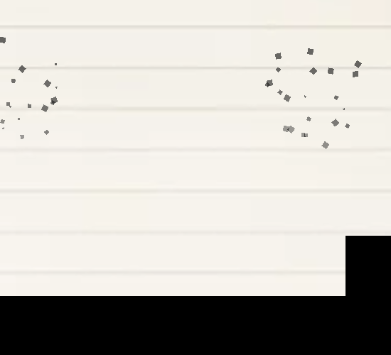

# 黑墨喷溅

碰撞伤害落地时，在受击点溅出一簇墨，范围随伤害放大，然后慢慢淡掉。**纯表现**：
不进物理世界、不动墨水账、不碰任何刚体。

（实拍：一次喷溅 —— 一颗颗沿弹道飞散的方块墨点，落点附近自然堆得密一些。）

## 三个角色

| | 谁 | 管什么 |
| --- | --- | --- |
| 事件源 | `root/src/impact_damage.gd` 的 `_record_hit()` | 每次**真正落地**的伤害记一条事件 |
| 协调 | `root/src/simulation_runtime.gd` 的 `_observe_damage()` | 每个固定步把 `result.hits` 交给所有实现 `observe_damage` 的扩展 |
| 表现 | `Ink/src/ink_spray.gd`（场景节点 `SimulationRuntime/InkSpray`） | 判阈值/去重，把每次伤害写成一条 splat 记录 |

⚠️ 上游 `HitFeedback` 里留了 `_emit_particles()` 钩子，但那个钩子按**冲量**驱动；本喷溅按**伤害**驱动
（范围要随伤害放大），所以走 `observe_damage` 这条，不挂在它上面。

伤害规则不认识墨水，表现层不认识伤害规则 —— 两边只通过通用效果包里的 `hits` 说话
（和红墨走 `observe_removals` 是同一套能力接口思路）。

## 事件字段

| 字段 | 含义 |
| --- | --- |
| `position` | 受击点（世界坐标） |
| `direction` | **受击方被推的方向**：砸地朝上、被侧撞朝撞击方向。⚠️ 不是「从表面朝外」——那对砸地就是往地里溅 |
| `amount` | 等效受损像素数，和 `InkHealth` 同一单位；玩家挨打就是扣掉的墨水量 |
| `material` | 受击处的材质 id |
| `player` | 受击方是不是玩家（是玩家就不看 `material`，直接按黑墨喷） |

## 纯 shader：没有粒子、没有贴图、没有实体

整个效果 = `ink_spray.gd` 建的一张 `ColorRect` + `Ink/asset/ink_splat.gdshader`：

- 每次喷溅只在着色器里存一条 `(位置, 方向, 出生时刻, 强度, 颜色)`，最多 8 条（`MAX_SPLATS`，满了顶掉最老的）。
- **墨滴轨迹是解析解**：`位置 = 中心 + 方向·速度·age + ½·重力·age²`；拖尾是「当前位置与上一瞬间位置
  连成的胶囊」，长度随速度变 —— 不需要逐帧模拟，也不存轨迹点。
- 四边形取所有喷溅范围的并集，**并裁到屏幕内**；着色器里每个像素还会先做一次粗剔除，
  所以看不见的地方不算。
- ⚠️ 四边形的 `mouse_filter` 必须是 `IGNORE`：画布落笔会查 `gui_get_hovered_control()`，
  一张盖住半屏的 Control 会把画笔全挡掉。
- ⚠️ 着色器里的数组长度 8 必须和 `ink_spray.gd` 的 `MAX_SPLATS` 一致。

## 参数（`Ink/src/ink_spray.gd` 的导出）

| 参数 | 默认 | 说明 |
| --- | --- | --- |
| `min_damage` | 2.0 | **阈值**：低于它完全不喷 |
| `reference_damage` | 40.0 | 强度 = 1 的伤害档位 |
| `max_strength` | **1.0** | **强度封顶**：到参考伤害就是最猛，再重的伤害也不会更强 |
| `strength_curve` | 1.6 | 强度曲线指数：>1 = 前段更平缓（斜率更小） |
| `min_speed` / `max_speed` | 90 / 260 | 满配初速区间（px/s），和寿命一起决定**喷溅范围** |
| `spread_degrees` | 62 | 喷溅锥角 |
| `lifetime` | 1.1 | 寿命；越大消去越慢 |
| `gravity` | 280 | 纯视觉重力。太大就变成「刚喷出来就往下掉」 |
| `opacity` | 0.75 | 墨的不透明度：**带点透明的黑**，叠得密的地方才更黑 |
| `drop_size` | 4 | 墨滴方块的边长上限（px）；实际在 1…它之间取整随机 |
| `drop_min` / `drop_max` | 4 / 22 | 刚过阈值 / 满配时的**墨点数量**，中间按伤害线性插值 |
| `spin_speed` | 2.5 | 方块自转速度（弧度/秒）；每颗的**出生角度随机**、转向和快慢也各不相同 |
| `dedup_cell` / `dedup_seconds` | 24 / 0.12 | 同一处的重复伤害抑制 |
| `max_sprays_per_step` | 4 | 一个固定步最多喷几簇 |

**阈值是量出来的**（真主场景）：普通落地 0.7 px；900–1400 px/s 的重砸 13–28 px。
默认 2 / 40 就落在「磕碰不喷、重击才喷」之间。要更敏感就降 `min_damage`。

## 强度随伤害怎么变

伤害先算成强度（**连续**，不分档）：

    ratio = (伤害 - min_damage) / reference_damage
    强度  = 0                              ratio ≤ 0（阈值以下，完全不喷）
          = ratio ^ strength_curve         ratio ≤ 1（指数压平 → 斜率比 1 小）
          = 1 + ln(ratio) / strength_curve  ratio > 1，继续涨但更慢
          = min(它, max_strength)          封顶

默认 **`max_strength = 1.0`**，所以**参考伤害就是最猛的表现**：到 `ratio = 1` 就满了，再重的伤害不再变化
（撞穿地图那种巨额伤害也不会把特效炸飞）。把 `max_strength` 调到 1 以上，对数增长段才会生效。

函数**连续且单调**（`ratio = 1` 处两边都等于 1），只在参考点有个缓弯：前段斜率是 `strength_curve`，
之后降到 `1 / strength_curve`。

默认参数下的实际取值（`min_damage = 2`、`reference_damage = 40`、`strength_curve = 1.6`、`max_strength = 1.0`）：

| 伤害 | 5 | 10 | 20 | 42 | 100 | 200 以上 |
| --- | --- | --- | --- | --- | --- | --- |
| 强度 | 0.02 | 0.08 | 0.28 | **1.00（满）** | 1.00 | 1.00 |

想更平缓就把 `strength_curve` 往上调（2、3…），想更陡就调回 1。

| 维度 | 怎么变 | 自己的上限 |
| --- | --- | --- |
| 墨点数量 | `drop_min` → `drop_max` 按强度插值取整 | `drop_max`（最先封顶） |
| 方块大小 | 边长 × `0.6 + 0.4 × 强度`（取整到 1..`drop_size`） | 强度 ≤ `max_strength` |
| 喷溅范围 | 初速 × `0.35 + 0.65 × 强度` | 速度按强度 1.6 封顶 |
| 存活时间 | `lifetime × (0.65 + 0.35 × 强度)` | 强度 ≤ `max_strength` |
| 是否喷 | 低于 `min_damage` 完全不喷 | — |

同一处的重复伤害还有去重（`dedup_cell` / `dedup_seconds`），一个固定步最多喷 `max_sprays_per_step` 簇。

## 形状是怎么算出来的

- **形状全是方块**：硬边（`box_alpha()` 用 `step()`，不抗锯齿、不圆角、不拉长），边长取整 ——
  像素风的墨点就是一个个小方块。
- **每颗方块的角度都不一样**：出生角度按 hash 随机（`h4 * TAU`），再各自以不同的速度和转向自转
  （`spin_speed`）；判边界前把点转进方块自己的坐标系。
- **墨滴**：在锥角内按 hash 撒 18 颗小方块（边长 1..`drop_size`），速度用 `pow(h, 1.6)` 偏慢 ⇒ 近密远疏。
- **透明渐变**：每颗墨点再乘一层 `gradient` —— 同一簇里飞得越远的越淡，整簇从落点往外就是一道渐变。
- **透明度**：`opacity` 是基数；同一坨墨里叠得越密越不透明（预乘 over 累加），中心自然更深。

## 颜色

方向取「受击方被推的方向」，所以**砸地是往上溅**（墨从脚下甩出来），侧撞则朝撞击方向飞。

- 受击方是玩家 → **黑墨**（`InkHealth.damage()` 只扣黑墨，见 `actor/player/doc/生命值.md`）。
- 其余 → 受击处的材料色；材料不是墨水（石头、手、隐形墨水）就**不喷**。
- 红墨爆炸走 `apply_impulse_damage()`，同样记 `hits`，所以被炸到也会溅。

## 验收

`test/test_ink_spray.gd`：39 checks / 0 failures。覆盖事件字段与方向、阈值、范围/强度/寿命随伤害放大、
颜色（玩家=黑墨、灰墨物体=灰）、不透明度 <1、硬边方块、透明渐变、同处去重、表满顶掉最老、寿命到点消失、
以及「整个效果只有一张四边形，没有粒子/贴图」和「不碰物理世界与墨水账」。
